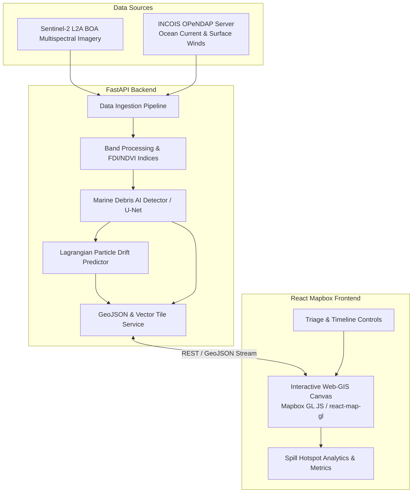

# Aquora: Marine Debris Triage Dashboard — Architecture Document

## 1. System Overview
**Aquora** is a Web-GIS decision-support system engineered to detect, classify, and track marine plastic debris spills in coastal and offshore environments. The platform fuses high-resolution multispectral Earth Observation (EO) imagery from **ESA Sentinel-2** with near-real-time hydrodynamic drift vectors sourced from **INCOIS (Indian National Centre for Ocean Information Services)** to provide automated triage, drift trajectory forecasting, and cleanup dispatch routing.

---

## 2. Layered Architecture

### 2.1 Backend Layer (`/backend`)
- **FastAPI Framework**: High-throughput asynchronous Python server delivering GeoJSON vector layers, analytical metrics, and triggering drift simulation jobs.
- **Data Ingestion Module**:
  - **OPeNDAP / pydap / xarray**: Pulls gridded oceanographic current datasets (zonal $u$ and meridional $v$ velocity components) directly from INCOIS THREDDS/OPeNDAP servers without downloading unnecessary global NetCDF binaries.
  - **Sentinel-2 Data Handler**: Fetches optical multispectral bands (B02, B03, B04, B08, B11, B12) via Planetary Computer / Copernicus Data Space API.
- **Inference & Analytical Engine**:
  - **Torch-based Detection**: Machine learning segmentation model (Floating Debris Index - FDI, baseline optical index + Deep Learning classifier) isolating floating plastic aggregations from sea sargassum/vegetation, foam, and clouds.
  - **Ocean Drift Simulation**: Computes 24h–72h forward Lagrangian trajectory paths factoring in INCOIS surface currents and wind drag coefficients ($C_d$).
- **API Endpoints**:
  - `GET /health` — Service and subsystem health status.
  - `GET /api/v1/detections` — Detected debris polygons with confidence scores & classification metadata.
  - `POST /api/v1/drift/forecast` — Drift trajectory computation for selected debris clusters.
  - `GET /api/v1/currents/vectors` — Gridded vector fields formatted for dynamic particle rendering on the client.

### 2.2 Frontend Layer (`/frontend`)
- **React + Vite**: High-performance Single Page Application built for rapid rendering and state synchronization.
- **Web-GIS Engine (`react-map-gl` & `mapbox-gl`)**:
  - Custom WebGL layers rendering multispectral bounding geometries, debris classification heatmaps, and animated ocean velocity streamline vectors.
  - Temporal scrub bar for historical spill tracking and predictive trajectory playback.
- **Tailwind CSS Design System**:
  - Dark-mode, glassmorphism-styled command center layout optimized for maritime monitoring and emergency operational dispatch.
  - KPI telemetry cards (Total Debris Area, Hazard Index, Drift Vector, Recovery Readiness).

---

## 3. End-to-End Data Flow

1. **Trigger & Fetch**: The backend periodically polls or receives targeted Area of Interest (AOI) bounding boxes.
2. **Spectral & Oceanographic Ingestion**:
   - Downloads required Sentinel-2 spectral bands.
   - Slices dynamic INCOIS ocean current slices $(u, v)$ across the bounding envelope.
3. **Detection & Triage Scoring**:
   - Optical index computation: $\text{FDI} = R_{\text{NIR}} - \left( R_{\text{RED2}} + (R_{\text{SWIR1}} - R_{\text{RED2}}) \times \frac{\lambda_{\text{NIR}} - \lambda_{\text{RED2}}}{\lambda_{\text{SWIR1}} - \lambda_{\text{RED2}}} \times 10 \right)$
   - Feature masking & confidence score attribution.
4. **Trajectory Modeling**: Computes spatial advection:
   $$\vec{x}(t + \Delta t) = \vec{x}(t) + \left( \vec{u}_{\text{current}} + \alpha \vec{u}_{\text{wind}} \right) \Delta t$$
5. **Client Presentation**: GeoJSON payloads stream to React frontend for real-time visualization on Mapbox layer stacks.

---

## 4. Technology Stack Summary

| Domain | Technology | Purpose |
| :--- | :--- | :--- |
| **Backend Core** | FastAPI, Uvicorn | Asynchronous RESTful API & WebSocket engine |
| **Scientific & GIS** | xarray, netCDF4, pydap, geojson | NetCDF slice extraction, OPeNDAP remote querying, geospatial structuring |
| **Machine Learning** | PyTorch, NumPy | Floating plastic spectral classification and segmentation |
| **Frontend Framework** | React 19, Vite | Modern reactive client architecture |
| **Mapping Engine** | Mapbox GL JS, react-map-gl | GPU-accelerated Web-GIS vector tile & particle visualization |
| **Styling** | Tailwind CSS | High-contrast maritime tactical command interface |
